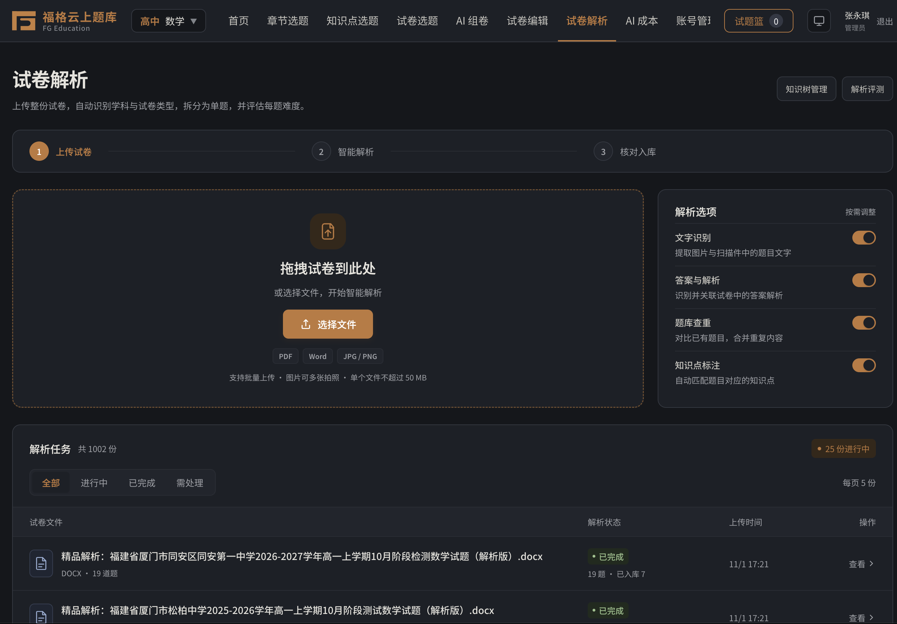
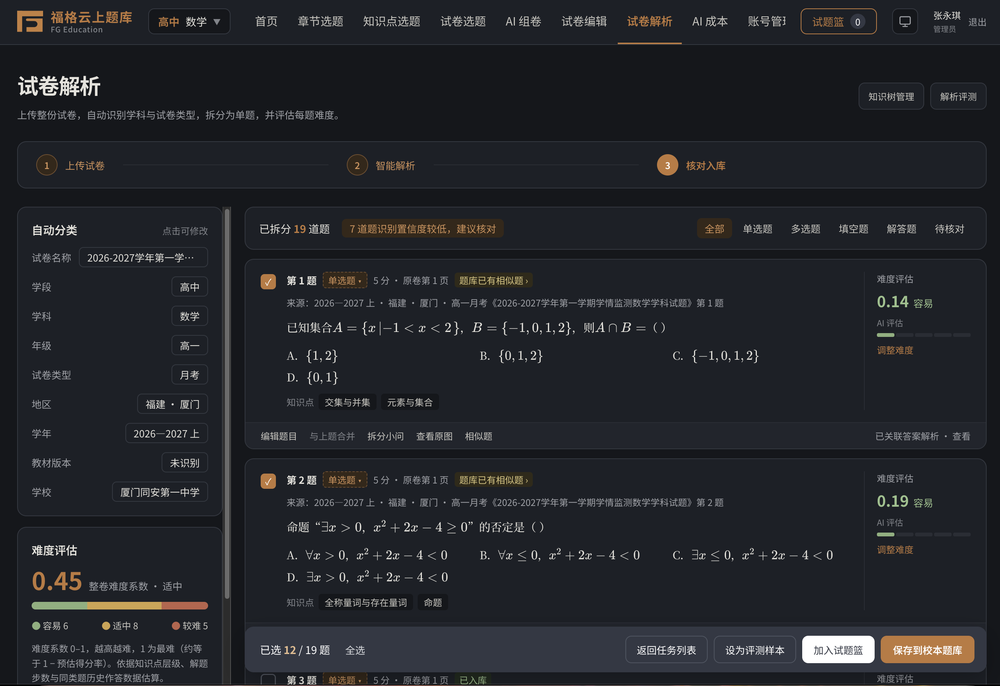
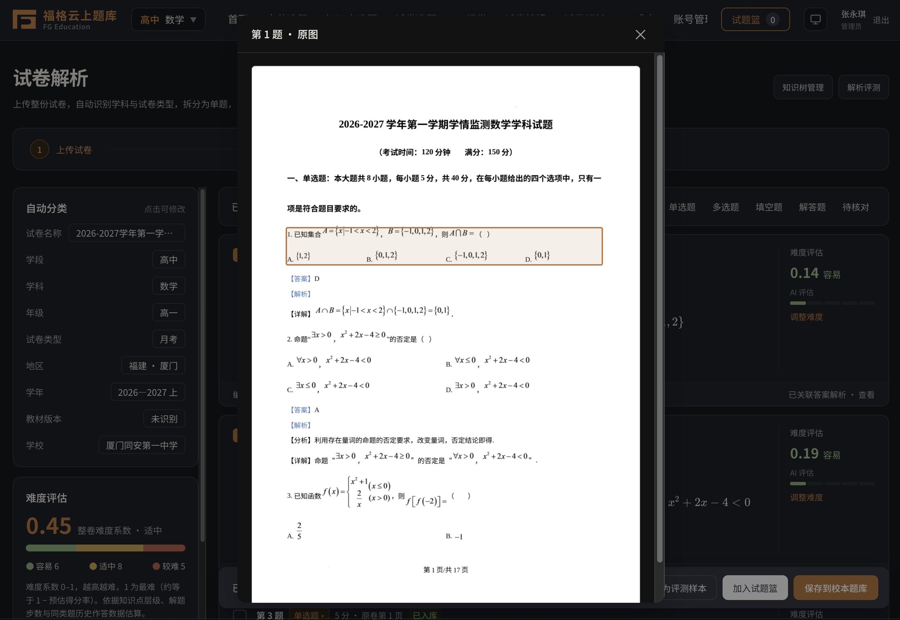
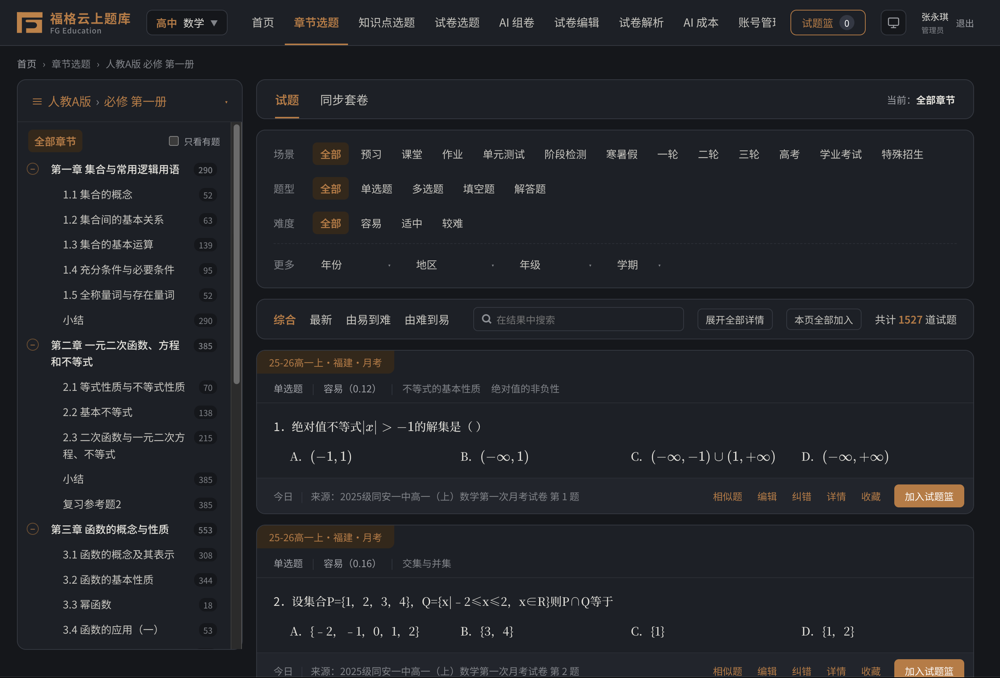
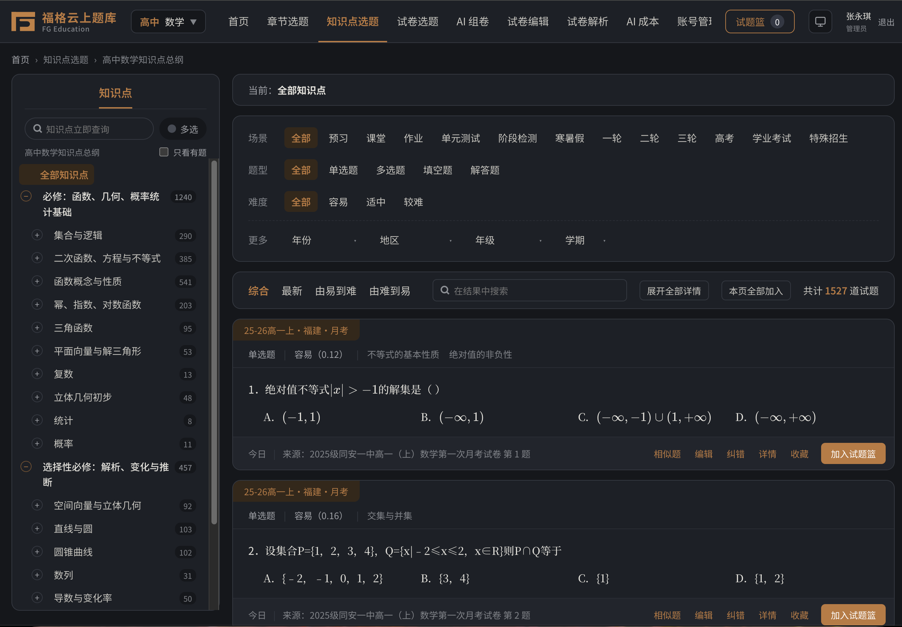
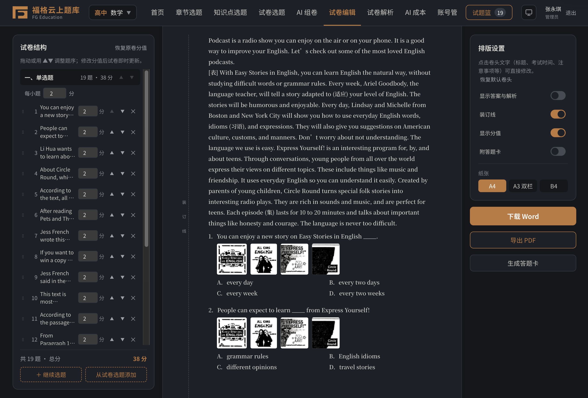
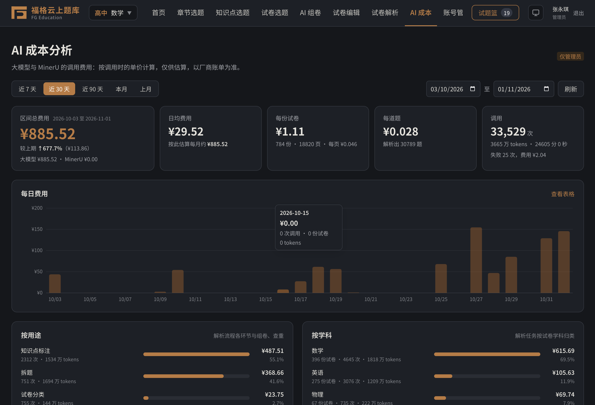
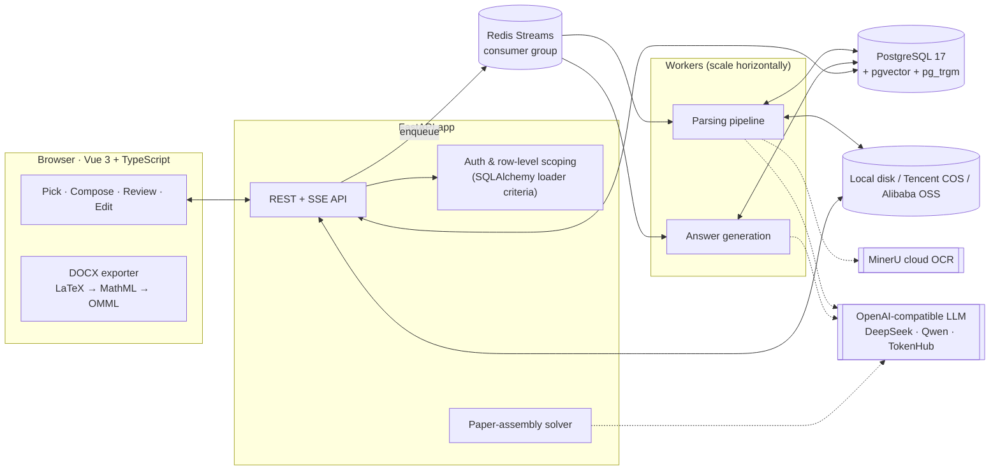
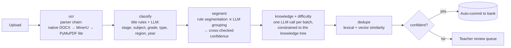

<div align="center">

# 福格云上题库 · FG Quiz Cloud

**An AI-powered exam-paper parsing and question-bank platform for K-12 schools.**

Teachers upload a PDF, Word file or phone photo of an exam paper. The system splits it into individual questions, tags knowledge points and difficulty, and generates answers. A teacher reviews the result before it goes into the school's question bank, where teachers can search, assemble new papers and export them to Word or PDF.

[](https://github.com/Peng-Rao/wuage-quiz-cloud/actions/workflows/ci.yml)


**English** · [简体中文（使用说明）](README.zh-CN.md)

<!-- SCREENSHOT PLACEHOLDER: replace docs/screenshots/hero.png -->


</div>

---

## At a glance

| | |
|---|---|
| **What** | A production system built for K-12 schools in Xiamen, China: it turns exam papers into a structured, searchable question bank shared by teachers |
| **My role** | Sole developer: product design, AI pipeline, backend, frontend, DevOps |
| **Timeline** | About 5 weeks from first commit to production, with automated deployment |
| **Scale of code** | ~11.6k lines of Python (FastAPI), ~10.9k lines of Vue/TypeScript, **259 backend tests** on real PostgreSQL and Redis in CI |
| **AI surface** | Exam classification, question segmentation, knowledge-point tagging, difficulty estimation, answer generation (text and vision), semantic duplicate detection, AI paper assembly |
| **Core idea** | The LLM is one signal that gets checked, not the source of truth. Rules, validation and teacher review sit around every model call, so the system stays accurate, low-cost and auditable |

---

## The problem

Every school keeps years of exam papers as scattered Word and PDF files. Turning them into a usable question bank by hand means retyping questions, re-entering formulas, and labelling each question with a topic and a difficulty. Generic "AI parsing" tools tend to fail in these ways:

- **Math breaks.** MathType objects, Word equations and scanned formulas come out garbled.
- **Questions split in the wrong places.** Sub-questions, shared reading passages, and answer keys at the end of the paper get mixed up.
- **Models make things up.** An LLM asked to rewrite questions can quietly change them. An LLM asked to pick questions can return IDs that don't exist, or totals that add up to 148 instead of 150.
- **Nobody can tell whether it's working or what it costs.**

The system handles each of these explicitly.

---

## Product tour

> Screenshots are placeholders. Drop images into [`docs/screenshots/`](docs/screenshots/) using the file names below.

### 1 · Upload → AI parsing → review

Drag in a PDF, a `.docx` or several phone photos. A live progress card (server-sent events) follows each stage. The review screen shows every parsed question with its type, score, answer, knowledge points, difficulty and a confidence flag. Teachers can merge, split or edit questions, and can open **the original page with the question's region highlighted** next to the parsed text.

| Parse review | Original page with highlighted region |
|---|---|
|  |  |

### 2 · Find questions by textbook chapter, knowledge point or paper

The bank can be browsed three ways. **Chapter trees** come from the textbook editions actually used in Xiamen (25 subject/edition catalogs). **Knowledge trees** cover 23 stage/subject combinations. The **paper library** lists whole papers. All three have per-node question counts and filters for type, difficulty, year, region and grade.

| Chapter picker | Knowledge-point picker |
|---|---|
|  |  |

| Paper library | Paper detail and review/assignment |
|---|---|
|  |  |

### 3 · AI paper assembly

The teacher describes the class in plain language, for example "Grade 10, weak on functions and trigonometry, midterm review, medium difficulty". The LLM turns that into a **blueprint**: knowledge points × question types × difficulty × counts. A **deterministic solver** then picks real questions from the bank and assigns scores so the total is exact. Teachers can refine over several turns ("make it easier", "two more proof questions").


### 4 · Paper editor → native Word export

Reorder sections and questions, set scores per question or per section, and paginate to A4 or A3. The app exports a **`.docx` with native, editable Word equations**, converted in the browser from LaTeX to MathML to OMML. It can also print to PDF or produce an answer sheet.


### 5 · Operations: accounts, AI cost, evaluation

Three roles (admin, subject leader, teacher) with per-subject data scoping and live online status. There is a per-call **AI cost dashboard** and an **offline evaluation harness** for the parsing pipeline.

| Accounts and permissions | AI cost analysis | Parse evaluation |
|---|---|---|
|  |  |  |

Dark mode is fully supported:


---

## Architecture



### The parsing pipeline



---

## AI engineering highlights

These are the design choices I would point to in this project.

### 1. LLMs return references, never rewritten content

During segmentation the model never retypes a question. It receives numbered **layout units** and returns only **groups of unit IDs** plus type and score. Question text is always rebuilt from the original parser output, so the model cannot change a formula or invent an option. The output is validated against the known IDs and repaired where possible. If the model drops most of the content, the run falls back to rule-based results. ([`segment.py`](server/app/pipeline/segment.py))

### 2. Two independent signals produce a confidence score

A hand-built rule segmenter (section headers, question numbers, options, scores, answer keys at the end) runs in parallel with the LLM. When they **agree**, confidence goes up. When they **disagree**, or the model's output needed repair, the question is flagged for review with a readable reason ("rules and LLM split differently"). Only confident questions with an answer and no duplicate are **auto-committed**; everything else goes to a teacher. ([`auto_commit.py`](server/app/auto_commit.py))

### 3. Constrained generation for knowledge tagging

Knowledge points must come from a curated tree. Small trees go into the prompt whole. For large trees the system first retrieves candidates and lets the model choose among them. Tags that aren't in the tree are kept but marked as such. Difficulty is estimated **in the same call** to save tokens, then blended with a position-based prior (`0.7 × LLM + 0.3 × baseline`). ([`knowledge.py`](server/app/pipeline/knowledge.py), [`difficulty.py`](server/app/pipeline/difficulty.py))

### 4. "LLM plans, algorithm solves" for paper assembly

Letting an LLM pick questions directly fails in predictable ways: wrong totals, invented IDs, banks too large for the context window, results that can't be reproduced. So the LLM makes **one** call to turn the request into a validated blueprint. A greedy solver then selects real questions (covering knowledge points, matching target difficulty, avoiding duplicates) and assigns scores from exam-style templates, scaled so the **total is always exact**. If the bank runs short, the gap is reported instead of hidden. I wrote the trade-off analysis in [`docs/ai-paper-assembly.md`](docs/ai-paper-assembly.md). ([`compose.py`](server/app/compose.py))

### 5. An evaluation harness and model calibration

Any paper a teacher has reviewed can be saved as a **gold sample**. One click re-parses all samples with the current configuration and reports:

`split precision/recall · type accuracy · option accuracy · answer accuracy · knowledge top-3 hit & recall · difficulty MAE · metadata accuracy`

The harness also fits a **linear calibration** (`y = a·x + b`) from teacher-adjusted difficulties back onto model output, showing MAE before and after. An admin can apply it with one click. This makes prompt and model changes measurable regressions instead of guesswork. ([`evaluation.py`](server/app/evaluation.py))

### 6. Cost tracking for every call

Every LLM and OCR call is recorded, failures included, with tokens, cached tokens, latency, purpose and subject. Cost is computed **at query time** from versioned prices that are **scraped daily** from vendor pricing pages (Tencent TokenHub, Alibaba Bailian, OpenRouter). Prices can be corrected afterwards and history recalculates. The dashboard shows cost per paper, per question, per pipeline stage and per model. ([`usage.py`](server/app/usage.py), [`pricing.py`](server/app/pricing.py))

### 7. Graceful degradation

Every AI component is optional. Without a MinerU token the system uses local parsing. Without an LLM it uses rule-based segmentation and keyword matching. Without embeddings it uses lexical similarity only. Word files are parsed **natively**, which is fast and costs no OCR, and only go to cloud OCR when the content is mostly images. The whole stack runs offline for development and CI.

### 8. Hybrid semantic duplicate detection

Similar questions are retrieved in two ways at once: **pgvector HNSW** for embeddings and **pg_trgm** for text. The results are then re-ranked with a blended score. For high-dimensional multimodal embeddings (4096-d, above HNSW's 2000-d limit), the index uses **binary-quantized vectors** (Hamming distance) and re-ranks by the original cosine similarity. Embedding providers can be swapped: OpenAI-compatible, Tencent multimodal, or local Hugging Face models. ([`similar.py`](server/app/similar.py))

### 9. Math stays correct end to end

- **Input:** MathType OLE objects are converted by a custom **MTEF v5 binary decoder**, Word equations by an **OMML** converter, both to LaTeX. Sub/superscripts in PDFs are recovered from font size and baseline position.
- **Display:** KaTeX, with a MathLive visual formula editor.
- **Output:** LaTeX → MathML → OMML, giving **native Word equations** that stay editable after export.
- **Original-page view:** Word files are rendered through LibreOffice. Parsed units are located on the rendered PDF pages so teachers can compare against the source.

---

## Engineering highlights

- **Distributed task queue on Redis Streams.** Consumer groups with deduplication, lease renewal, `XAUTOCLAIM` takeover of tasks from dead workers, re-queueing on startup, and handing tasks back on graceful shutdown. Workers scale with `docker compose up --scale worker=N`. ([`worker.py`](server/app/worker.py))
- **Row-level authorization in the ORM.** Every request's database session has `with_loader_criteria` rules attached. A teacher can only load questions assigned to them and approved, and a subject leader only their own subjects, **including in aggregates and counts**. One query can't forget the permission check. ([`auth.py`](server/app/auth.py))
- **Security basics.** scrypt with a per-user salt, HttpOnly SameSite cookies, only hashed session tokens stored server-side, login rate limiting by account and IP, and all sessions revoked when a role or password changes.
- **Pluggable object storage.** Local disk, Tencent COS or Alibaba OSS, with browser direct upload via pre-signed URLs and a migration tool between backends.
- **CI/CD with automatic rollback.** CI runs type-check and build, Ruff, pytest against real PostgreSQL+pgvector and Redis, then builds the Docker image and smoke-tests the Compose stack. On `main`, the deploy workflow pushes the image and SSHes into the server. There it **backs up the database, switches containers, waits for health checks, and rolls back to the previous image and commit if they fail**. ([`deploy.sh`](deploy/deploy.sh))
- **Multi-arch image.** amd64/arm64, non-root user, `tini` as PID 1 to reap LibreOffice's orphaned processes (a real production bug, fixed in [`aeb9603`](https://github.com/Peng-Rao/wuage-quiz-cloud/commit/aeb9603)).

---

## Tech stack

| Layer | Technology |
|---|---|
| Frontend | Vue 3.5, TypeScript 5.9, Vite, Pinia, Vue Router, KaTeX, MathLive, JSZip (DOCX generation) |
| Backend | Python 3.13, FastAPI, SQLAlchemy 2, Pydantic v2, httpx, PyMuPDF, LibreOffice (headless) |
| Data | PostgreSQL 17 + pgvector (HNSW) + pg_trgm, Redis 8 (Streams) |
| AI | OpenAI-compatible chat API (DeepSeek, Qwen, Tencent TokenHub), vision models, MinerU OCR, text and multimodal embeddings, optional local `sentence-transformers` |
| Infra | Docker (multi-stage, multi-arch), Docker Compose, GitHub Actions, Tencent COS / Alibaba OSS |
| Quality | pytest (259 tests), respx (HTTP mocking), fakeredis, Ruff, vue-tsc |

---

## Quick start

```bash
cp server/.env.example server/.env        # optional: MinerU token, LLM endpoint & key
docker compose up -d --build              # app + worker + PostgreSQL + Redis → http://localhost:8000
docker compose exec app python -m app.create_admin admin   # create the first admin (password prompted)
```

The app runs **without any API keys** (local parsing and rule-based segmentation). Add `LLM_BASE_URL`, `LLM_API_KEY` and `LLM_MODEL` in `server/.env` to turn on the AI features.

Local development with hot reload:

```bash
docker compose up -d db redis
cd server && uv sync && uv run uvicorn app.main:app --port 8000 --reload
```

```bash
npm install && npm run dev                # http://localhost:5173, proxies /api → :8000
```

Full guide (production, HTTPS, object storage, backups, auto-deploy): **[docs/deployment.md](docs/deployment.md)**

---

## Repository layout

```
├── src/                      # Vue 3 frontend
│   ├── views/                #   pages: pick, compose, papers, editor, upload/review, users, cost, eval
│   ├── components/           #   question cards, review panel, formula editor, source viewer…
│   ├── utils/docx.ts, omml.ts#   in-browser DOCX export with native Word equations
│   └── api/                  #   typed API clients
├── server/
│   ├── app/pipeline/         # parsing pipeline: parsers/, classify, segment, knowledge, difficulty, answer, vision
│   ├── app/api/              # FastAPI routers
│   ├── app/compose.py        # AI paper-assembly solver
│   ├── app/similar.py        # hybrid lexical + vector retrieval
│   ├── app/worker.py         # Redis Streams task queue
│   ├── app/evaluation.py     # evaluation harness and difficulty calibration
│   ├── app/data/             # 23 knowledge trees, 25 textbook chapter catalogs
│   ├── scripts/              # textbook catalog crawler, knowledge-tree builder
│   └── tests/                # 259 tests
├── docs/                     # API contract, deployment guide, AI paper-assembly design
├── deploy/deploy.sh          # zero-downtime deploy with backup and auto-rollback
└── docker-compose*.yml
```

---

## What I'd do next

These are honest limitations, kept as a roadmap:

- **Assembly v2:** student profiles, conversational tool calling with streaming, and swapping the greedy solver for CP-SAT as constraints grow (designed in [`docs/ai-paper-assembly.md`](docs/ai-paper-assembly.md)).
- **Mastery modelling:** estimate per-knowledge-point mastery from grade sheets and response data before adopting IRT.
- **Schema migrations:** move from additive startup migrations to Alembic.
- **Bank scale:** a question↔knowledge-point join table and indexes for banks of tens of thousands of questions.

---

## Documentation

| Document | Content |
|---|---|
| [README.zh-CN.md](README.zh-CN.md) | Chinese user guide: roles, review workflow, page list |
| [docs/deployment.md](docs/deployment.md) | Deployment, configuration, backups, auto-deploy, FAQ |
| [docs/ai-parse-api.md](docs/ai-parse-api.md) | Parsing API contract |
| [docs/ai-paper-assembly.md](docs/ai-paper-assembly.md) | AI paper assembly: architecture and technology trade-offs |
| [server/README.md](server/README.md) | Backend modules, pipeline and configuration reference |
