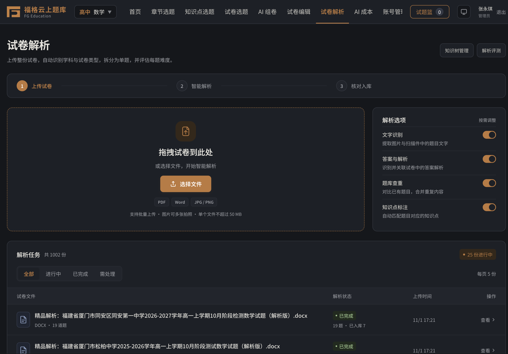
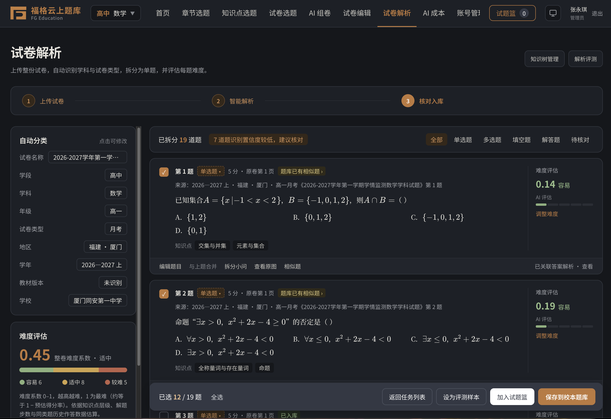
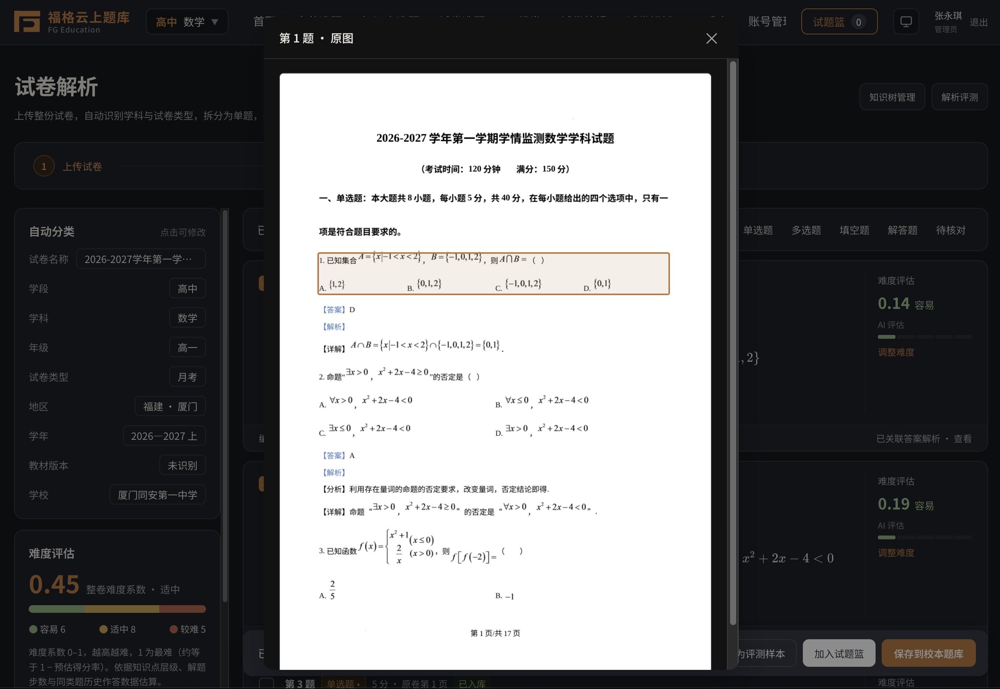
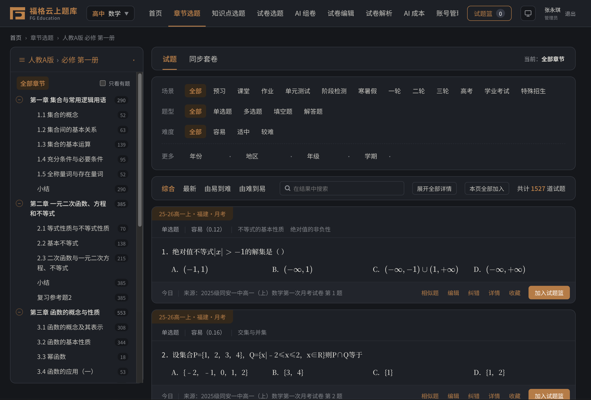
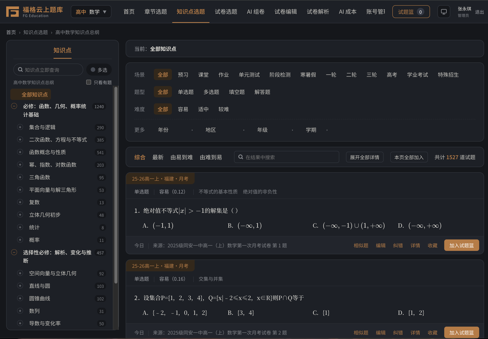
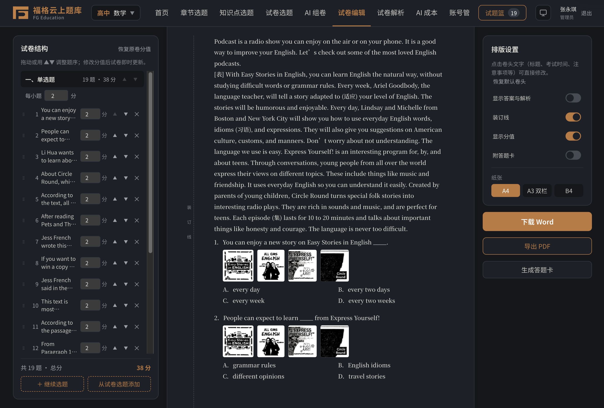
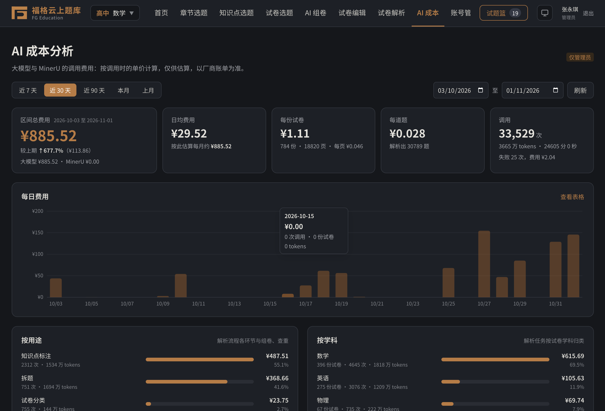
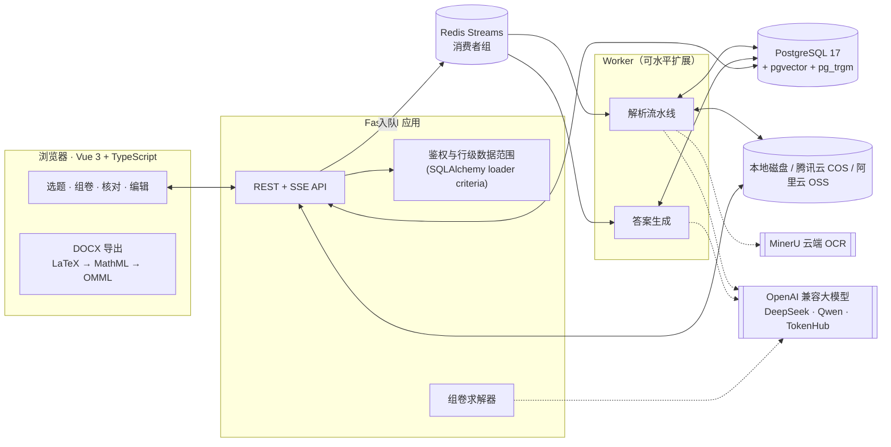
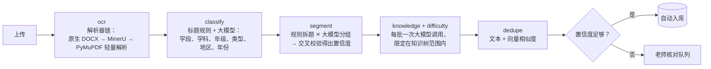

<div align="center">

# 福格云上题库 · FG Quiz Cloud

**面向中小学的 AI 试卷解析与校本题库平台。**

老师上传 PDF、Word 或手机拍摄的试卷，系统自动拆分为单题，标注知识点和难度，并生成答案。老师审核后题目进入校本题库，可用于搜题、组卷，并导出 Word 或 PDF。

[](https://github.com/Peng-Rao/wuage-quiz-cloud/actions/workflows/ci.yml)


[English](README.md) · **简体中文**



</div>

---

## 项目概览

| | |
|---|---|
| **项目内容** | 为厦门中小学打造的生产系统，把试卷转化为老师共用、结构化、可检索的题库 |
| **我的角色** | 独立开发：产品设计、AI 流水线、后端、前端、DevOps |
| **周期** | 从第一次提交到上线约 5 周，并实现自动部署 |
| **代码规模** | 约 1.16 万行 Python（FastAPI），约 1.09 万行 Vue/TypeScript，**259 个后端测试**在 CI 中基于真实的 PostgreSQL 和 Redis 运行 |
| **AI 能力** | 试卷分类、拆题、知识点标注、难度评估、答案生成（文本与视觉）、语义查重、AI 组卷 |
| **核心思路** | 大模型只是一个需要校验的信号，而不是事实来源。每次模型调用都有规则、校验和老师审核把关，让系统保持准确、低成本、可追溯 |

---

## 要解决的问题

每所学校都积累了多年的试卷，散落在各种 Word 和 PDF 文件里。要手工把它们整理成可用的题库，就得重新录入题目和公式，再逐题标注知识点和难度。通用的「AI 解析」工具往往在这些地方出问题：

- **数学公式出错。** MathType 对象、Word 公式和扫描件中的公式解析后变成乱码。
- **拆题位置不对。** 小问、共用的阅读材料和卷末答案混在一起。
- **模型编造内容。** 让大模型重写题目，它可能悄悄改掉内容；让大模型选题，它可能返回不存在的编号，或者总分凑成 148 而不是 150。
- **效果和成本都看不清。** 没人说得清它到底好不好用、花了多少钱。

本系统针对这些问题逐一做了处理。

---

## 产品导览

### 1 · 上传 → AI 解析 → 核对

拖入 PDF、`.docx` 或多张手机照片。实时进度卡片（基于服务器推送事件 SSE）展示每个解析阶段。核对页面列出每道解析出的题目，包括题型、分值、答案、知识点、难度和置信度标记。老师可以合并、拆分或编辑题目，也可以在解析文本旁打开**原卷页面，并高亮该题所在区域**。

| 核对解析结果 | 原卷页面与高亮区域 |
|---|---|
|  |  |

### 2 · 按教材章节、知识点或试卷找题

题库有三种浏览方式。**章节目录**来自厦门实际使用的教材版本（25 套学科/版本目录）。**知识树**覆盖 23 个学段/学科组合。**试卷库**按整卷展示。三种方式都显示各节点的题目数量，并支持按题型、难度、年份、地区和年级筛选。

| 章节选题 | 知识点选题 |
|---|---|
|  |  |

### 3 · AI 组卷

老师用自然语言描述班级情况，例如「高一，函数和三角函数薄弱，期中复习，中等难度」。大模型把这段话整理成**组卷蓝图**：知识点 × 题型 × 难度 × 题量。**确定性求解器**再从题库中选出真实题目并赋分，保证总分准确。老师可以多轮调整（「简单一点」「再加两道证明题」）。

### 4 · 试卷编辑 → 导出原生 Word

调整大题和题目的顺序，逐题或按大题赋分，并按 A4 或 A3 分页。系统导出的 **`.docx` 使用可编辑的 Word 原生公式**，在浏览器中完成 LaTeX → MathML → OMML 的转换。也可以打印为 PDF 或生成答题卡。



### 5 · 运营管理：账号、AI 成本、评测

系统有三种角色（管理员、学科组长、老师），按学科隔离数据，并显示账号在线状态。还提供按调用计费的 **AI 成本看板**，以及针对解析流水线的**离线评测工具**。系统完整支持深色模式。



---

## 系统架构



### 解析流水线



---

## AI 工程亮点

下面是这个项目中我最想介绍的设计决策。

### 1. 大模型只返回引用，不改写内容

拆题时模型不会重新输出题目文本。它收到带编号的**版面单元**，只返回**单元编号分组**以及题型和分值。题目文本始终由解析器的原始输出重建，因此模型无法改动公式或编造选项。输出会对照已知编号校验，并尽可能修复。如果模型丢失了大部分内容，这次运行就回退到规则结果。（[`segment.py`](server/app/pipeline/segment.py)）

### 2. 两路独立信号得出置信度

人工编写的规则拆题器（识别大题标题、题号、选项、分值、卷末答案）与大模型并行运行。两者**一致**时置信度上升。两者**不一致**，或模型输出经过修复时，题目会被标记待核对，并附上可读的原因（「规则与大模型拆分结果不同」）。只有置信度足够、有答案且不重复的题目才会**自动入库**，其余都交给老师。（[`auto_commit.py`](server/app/auto_commit.py)）

### 3. 用受限生成做知识点标注

知识点必须来自整理好的知识树。较小的知识树直接整棵放进提示词。对于较大的知识树，系统先召回候选，再让模型从中选择。不在树中的标签会保留，但会加以标记。难度在**同一次调用**中估算以节省 token，再与基于题目位置的先验值融合（`0.7 × LLM + 0.3 × baseline`）。（[`knowledge.py`](server/app/pipeline/knowledge.py)、[`difficulty.py`](server/app/pipeline/difficulty.py)）

### 4. 组卷采用「大模型规划，算法求解」

让大模型直接选题，失败方式是可以预见的：总分不对、编造编号、题库太大放不进上下文、结果无法复现。所以大模型只调用**一次**，把需求转换成经过校验的蓝图。然后由贪心求解器选出真实题目（覆盖知识点、匹配目标难度、避免重复），再按考试风格的模板赋分并缩放，确保**总分始终准确**。题库题量不足时，系统会报告缺口而不是掩盖。我把方案取舍写在了 [`docs/ai-paper-assembly.md`](docs/ai-paper-assembly.md)。（[`compose.py`](server/app/compose.py)）

### 5. 评测工具与模型校准

老师核对过的任何试卷都可以保存为**评测样本**。一键即可用当前配置重新解析所有样本，并输出：

`拆题精确率/召回率 · 题型准确率 · 选项准确率 · 答案准确率 · 知识点 top-3 命中率与召回率 · 难度 MAE · 元数据准确率`

评测工具还会根据老师调整过的难度，对模型输出拟合**线性校准**（`y = a·x + b`），并展示校准前后的 MAE。管理员可一键应用。这样提示词和模型的改动都能用回归结果衡量，不必靠猜。（[`evaluation.py`](server/app/evaluation.py)）

### 6. 每次调用都记录成本

每次大模型和 OCR 调用都会被记录（包括失败的调用），内容包括 token、缓存 token、延迟、用途和学科。成本在**查询时**计算，所用的版本化价格**每天**从厂商定价页面抓取（腾讯 TokenHub、阿里云百炼、OpenRouter）。价格可以事后修正，历史成本会随之重新计算。看板按试卷、题目、流水线环节和模型展示成本。（[`usage.py`](server/app/usage.py)、[`pricing.py`](server/app/pricing.py)）

### 7. 优雅降级

每个 AI 组件都是可选的。没有 MinerU token 时使用本地解析。没有大模型时使用规则拆题和关键词匹配。没有向量嵌入时只用文本相似度。Word 文件走**原生解析**，速度快且不产生 OCR 费用，只有内容以图片为主时才交给云端 OCR。整套系统可以离线运行，用于开发和 CI。

### 8. 混合语义查重

相似题同时通过两种方式召回：向量使用 **pgvector HNSW**，文本使用 **pg_trgm**，然后用融合分数重排。高维多模态向量（4096 维，超过 HNSW 的 2000 维上限）的索引使用**二值量化向量**（汉明距离），再按原始余弦相似度重排。嵌入服务可以替换：OpenAI 兼容接口、腾讯多模态接口或本地 Hugging Face 模型。（[`similar.py`](server/app/similar.py)）

### 9. 数学公式全程保真

- **输入：** MathType OLE 对象通过自研的 **MTEF v5 二进制解码器**转换，Word 公式通过 **OMML** 转换器转换，都转为 LaTeX。PDF 中的上下标根据字号和基线位置恢复。
- **显示：** 使用 KaTeX，并提供 MathLive 可视化公式编辑器。
- **输出：** LaTeX → MathML → OMML，生成导出后仍可编辑的 **Word 原生公式**。
- **查看原图：** Word 文件通过 LibreOffice 渲染，解析出的单元会定位到渲染后的 PDF 页面上，方便老师与原卷对照。

---

## 工程亮点

- **基于 Redis Streams 的分布式任务队列。** 使用消费者组，支持去重、租约续期、通过 `XAUTOCLAIM` 接管失效 Worker 的任务、启动时重新入队，以及优雅关闭时交还任务。Worker 可通过 `docker compose up --scale worker=N` 扩容。（[`worker.py`](server/app/worker.py)）
- **ORM 层的行级权限。** 每个请求的数据库会话都附加了 `with_loader_criteria` 规则。老师只能加载分配给自己且审核通过的题目，学科组长只能加载自己学科的数据，**聚合和计数也不例外**。单条查询不会漏掉权限检查。（[`auth.py`](server/app/auth.py)）
- **基础安全措施。** 使用带独立盐的 scrypt，HttpOnly、SameSite Cookie，服务端只保存会话令牌的哈希，按账号和 IP 限制登录频率，角色或密码变更时撤销全部会话。
- **可插拔的对象存储。** 支持本地磁盘、腾讯云 COS 和阿里云 OSS，支持通过预签名 URL 从浏览器直传，并提供存储后端之间的迁移工具。
- **带自动回滚的 CI/CD。** CI 运行类型检查与构建、Ruff，以及基于真实 PostgreSQL+pgvector 和 Redis 的 pytest，然后构建 Docker 镜像并对 Compose 服务做冒烟测试。在 `main` 分支上，部署工作流推送镜像并通过 SSH 登录服务器，在服务器上**备份数据库、切换容器、等待健康检查，失败时回滚到上一个镜像和提交**。（[`deploy.sh`](deploy/deploy.sh)）
- **多架构镜像。** 支持 amd64/arm64，使用非 root 用户，并以 `tini` 作为 PID 1 回收 LibreOffice 的孤儿进程（这是一个真实的生产问题，修复于 [`aeb9603`](https://github.com/Peng-Rao/wuage-quiz-cloud/commit/aeb9603)）。

---

## 技术栈

| 层 | 技术 |
|---|---|
| 前端 | Vue 3.5、TypeScript 5.9、Vite、Pinia、Vue Router、KaTeX、MathLive、JSZip（生成 DOCX） |
| 后端 | Python 3.13、FastAPI、SQLAlchemy 2、Pydantic v2、httpx、PyMuPDF、LibreOffice（无头模式） |
| 数据 | PostgreSQL 17 + pgvector（HNSW）+ pg_trgm、Redis 8（Streams） |
| AI | OpenAI 兼容对话接口（DeepSeek、Qwen、腾讯 TokenHub）、视觉模型、MinerU OCR、文本与多模态嵌入，可选本地 `sentence-transformers` |
| 基础设施 | Docker（多阶段、多架构）、Docker Compose、GitHub Actions、腾讯云 COS / 阿里云 OSS |
| 质量保障 | pytest（259 个测试）、respx（HTTP 模拟）、fakeredis、Ruff、vue-tsc |

---

## 快速开始

```bash
cp server/.env.example server/.env        # 可选：填写 MinerU token、大模型地址和密钥
docker compose up -d --build              # app + worker + PostgreSQL + Redis → http://localhost:8000
docker compose exec app python -m app.create_admin admin   # 创建首个管理员（交互输入密码）
```

应用**不需要任何 API 密钥**即可运行（使用本地解析和规则拆题）。在 `server/.env` 中添加 `LLM_BASE_URL`、`LLM_API_KEY` 和 `LLM_MODEL` 即可开启 AI 功能。

本地开发（支持热重载）：

```bash
docker compose up -d db redis
cd server && uv sync && uv run uvicorn app.main:app --port 8000 --reload
```

```bash
npm install && npm run dev                # http://localhost:5173，/api 代理到 :8000
```

完整指南（生产环境、HTTPS、对象存储、备份、自动部署）：**[docs/deployment.md](docs/deployment.md)**

---

## 目录结构

```
├── src/                      # Vue 3 前端
│   ├── views/                #   页面：选题、组卷、试卷库、编辑器、上传/核对、账号、成本、评测
│   ├── components/           #   题目卡片、核对面板、公式编辑器、原图查看器等
│   ├── utils/docx.ts, omml.ts#   在浏览器中导出带 Word 原生公式的 DOCX
│   └── api/                  #   带类型的 API 客户端
├── server/
│   ├── app/pipeline/         # 解析流水线：parsers/、classify、segment、knowledge、difficulty、answer、vision
│   ├── app/api/              # FastAPI 路由
│   ├── app/compose.py        # AI 组卷求解器
│   ├── app/similar.py        # 文本 + 向量混合召回
│   ├── app/worker.py         # Redis Streams 任务队列
│   ├── app/evaluation.py     # 评测工具与难度校准
│   ├── app/data/             # 23 棵知识树、25 套教材章节目录
│   ├── scripts/              # 教材目录爬虫、知识树构建脚本
│   └── tests/                # 259 个测试
├── docs/                     # API 约定、部署指南、使用说明、AI 组卷设计
├── deploy/deploy.sh          # 带备份和自动回滚的零停机部署
└── docker-compose*.yml
```

---

## 后续计划

以下是目前实际存在的不足，也是接下来的路线图：

- **组卷 v2：** 学生画像、支持流式输出的对话式工具调用；随着约束增多，用 CP-SAT 替换贪心求解器（设计见 [`docs/ai-paper-assembly.md`](docs/ai-paper-assembly.md)）。
- **掌握度建模：** 先根据成绩单和作答数据估算每个知识点的掌握度，再考虑引入 IRT。
- **数据库迁移：** 从启动时的增量迁移改为 Alembic。
- **题库规模：** 增加题目与知识点的关联表和索引，以支撑数万道题的题库。

---

## 文档

| 文档 | 内容 |
|---|---|
| [docs/user-guide.zh-CN.md](docs/user-guide.zh-CN.md) | 中文使用说明：角色权限、审核流程、页面列表 |
| [docs/deployment.md](docs/deployment.md) | 部署、配置、备份、自动部署、常见问题 |
| [docs/ai-parse-api.md](docs/ai-parse-api.md) | 解析 API 约定 |
| [docs/ai-paper-assembly.md](docs/ai-paper-assembly.md) | AI 组卷：架构与技术取舍 |
| [server/README.md](server/README.md) | 后端模块、流水线与配置参考 |
